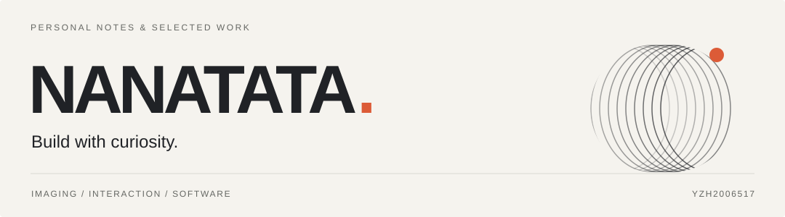

<picture>
  <source media="(prefers-color-scheme: dark)" srcset="assets/identity-dark.svg">
  
</picture>

<a href="https://yzh2006517.github.io/">个人网站 ↗</a> &nbsp; / &nbsp; <a href="mailto:zhenhao897@gmail.com">联系我 ↗</a>

### 你好，我是 NANATATA。

我做影像工具，也做 AI 交互应用。喜欢把复杂的处理过程，变成直观、可以亲手体验的软件。

最近在探索 **胶片与计算摄影**、**桌面与移动端体验**，以及 **AI 如何参与实时互动**。从界面细节到处理链路，我希望作品既讲得清楚，也用得顺手。

### 精选作品 Selected work

| 项目 | 一句话介绍 |
| :--- | :--- |
| **[Photo All Studio ↗](https://github.com/YZH2006517/Photo-All)** Windows · Tauri / React / Python | 把照片放上电子观片台，完成选片、RAW 显影与调色；本地处理，保留原片。 |
| **[Photo All · Android ↗](https://github.com/YZH2006517/Photo-All-Android)** Android · Kotlin / C++ / Vulkan · 开发中 | 把光谱胶片模拟带到手机 GPU，从实时取景到胶片、相纸的冲洗流程。 |
| **[AI 直播助手 ↗](https://github.com/YZH2006517/ai-virtual-streamer)** Windows · Python / Live2D | 让数字人回应弹幕、陪观众聊天，并主持互动小游戏。 |

Photo All 的光谱模拟基于 Spektrafilm / vkdt 等开源工作，具体实现与致谢见各项目仓库。

### 保持联系 Let's connect

欢迎聊工作机会、科研交流、开源协作，也欢迎带来一个值得一起解决的问题。

**[zhenhao897@gmail.com](mailto:zhenhao897@gmail.com)** &nbsp; · &nbsp; [个人网站](https://yzh2006517.github.io/)

English · A little about me

I’m **NANATATA**. I build imaging tools and AI-powered interactive applications, turning complex processes into software people can explore and use.

My current work spans a local photo light table and editor for Windows, a spectral film camera for Android (in development), and an interactive AI livestream assistant. See the repositories above for details and upstream credits.

Open to work opportunities, research conversations and collaboration: **[zhenhao897@gmail.com](mailto:zhenhao897@gmail.com)**.

