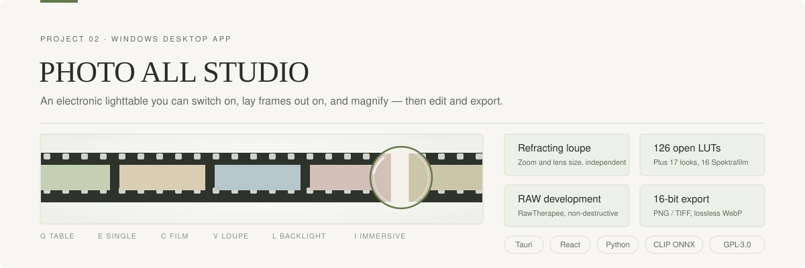

<picture>
  <source media="(prefers-color-scheme: dark)" srcset="assets/banner-dark.svg">
  
</picture>

**中文** ｜ **[English ↓](#english)**

### 你好，我是 NANATATA 👋

**把想法，做成能用的东西。**

关注 AI 应用、人机交互与工程落地。目前在做两个 Windows 桌面软件：一个让 Live2D 形象陪着直播间聊天，一个把胶片放到电子观片台上细看和修图。两个都能下载到 exe，不是演示 demo。

**[个人网站上有几张说明图，讲清它们内部怎么跑 →](https://yzh2006517.github.io/)**
一条弹幕从直播间网页走到 OBS 要过哪些环节，原片为什么从头到尾都没被改过。

[zhenhao897@gmail.com](mailto:zhenhao897@gmail.com)

---

## 作品

<a href="https://github.com/YZH2006517/ai-virtual-streamer">
  <picture>
    <source media="(prefers-color-scheme: dark)" srcset="assets/card-streamer-dark.svg">
    
  </picture>
</a>

### [AI 虚拟主播](https://github.com/YZH2006517/ai-virtual-streamer)

一个 Live2D 主播看着抖音弹幕陪观众聊天，还能跟着音乐跳舞、主持弹幕小游戏。下载一个 exe 就能用，填自己的大模型 API Key。

| 能做什么 | 实现重点 |
| --- | --- |
| 读弹幕回答 | 读直播间网页留言并排队，留言多时合并回答，支持屏蔽词 |
| 人设与形象 | 性格、声音、场景一键换；可导入自己的 Cubism 3 模型（zip） |
| 弹幕小游戏 | 猜数字、答题挑战由大模型现场出题，程序判题计分并上排行榜 |
| 舞台与导播 | 跟节拍跳舞，组件位置图层逐场景可调，WebView2 画面给 OBS 采集 |
| 成本可见 | 本地账本记录当天 token 花费与礼物收入 |

整条链路只有大模型和语音两步在云端，其余都在本机。

Python · Live2D Cubism · Edge TTS · WebView2 ｜ MIT ｜ API Key 用 Windows DPAPI 加密存本机

[说明图](https://yzh2006517.github.io/#streamer) · [下载 Releases](https://github.com/YZH2006517/ai-virtual-streamer/releases) · [源码](https://github.com/YZH2006517/ai-virtual-streamer)

 

<a href="https://github.com/YZH2006517/Photo-All">
  <picture>
    <source media="(prefers-color-scheme: dark)" srcset="assets/card-photo-dark.svg">
    
  </picture>
</a>

### [Photo All Studio](https://github.com/YZH2006517/Photo-All)

从导入到出片，整条路都在一个软件里。三件事是它和普通看图软件的区别：

| 三件事 | 一句话 | 具体 |
| --- | --- | --- |
| **整合** | 一条链路 | 导入、离线识图、审阅、调色、RAW 显影、导出都在同一个窗口里，不用来回倒腾别的软件；图集只登记路径，不复制原文件 |
| **沉浸** | 它是观片台 | 实体灯箱式背光，自由拖片与一键平铺，连续胶卷首尾相接横向滑动；折射放大镜倍率与镜片尺寸独立调节，镜外保留整张台面 |
| **精度** | 编辑模式不妥协 | 所有运算在 float32 线性空间里做，屏幕只是降到 8-bit 给你看；导出时按同一份配方重算成 16-bit，显示器上让掉的精度不会进到文件里 |

胶片模拟就打在真实画面上，不是色块：126 款开放 LUT、17 款创意风格、16 款 Spektrafilm 色彩，搜索分组与联动筛选。

**原片从头到尾只读** —— 只在导出那一刻回头读原始像素，从不写回磁盘；销毁图集只清记录，磁盘上的文件一个不动。

Tauri · React · Python · RawTherapee · Spektrafilm · CLIP ONNX ｜ GPL-3.0 ｜ Windows 10/11 x64

[说明图](https://yzh2006517.github.io/#photo) · [下载 Releases](https://github.com/YZH2006517/Photo-All/releases) · [源码](https://github.com/YZH2006517/Photo-All)

---

## 关注方向

- **AI 应用** — 让模型的理解与生成能力进入具体场景，而不是停在接口调用。
- **人机交互** — 把语言、语音、画面和实际操作连起来。
- **工程落地** — 完整链路、状态管理、异常处理，以及能交到别人手上的安装包。

## 联系

欢迎工作机会、科研交流与开源协作。

📮 **[zhenhao897@gmail.com](mailto:zhenhao897@gmail.com)** ｜ 🌐 **[yzh2006517.github.io](https://yzh2006517.github.io/)**

---

## English

**[↑ 中文](https://github.com/YZH2006517)** ｜ **English**

### Hi, I am NANATATA 👋

**Turn ideas into things people can use.**

I work on AI applications, human-computer interaction and actually shipping things. Two Windows desktop apps at the moment: one puts a Live2D host in a live room to talk with the chat, the other puts film on an electronic light table to inspect and grade. Both download as an exe — not demos.

**[The personal site has diagrams explaining how they work inside →](https://yzh2006517.github.io/)**
What a single comment passes through on its way from the live page to OBS, and why your original files are never touched.

[zhenhao897@gmail.com](mailto:zhenhao897@gmail.com)

### [AI Virtual Streamer](https://github.com/YZH2006517/ai-virtual-streamer)

A Live2D host reads the Douyin live chat and talks back, dances to the music, and runs chat minigames. One exe, your own LLM API key.

| What it does | How it works |
| --- | --- |
| Answers the chat | Scrapes and queues live-room comments, merges them when chat floods, honours a blocklist |
| Persona and model | Swap personality, voice and scene in one click; drop in your own Cubism 3 model as a zip |
| Chat minigames | The LLM writes number-guessing and quiz rounds live; the app scores them and keeps the leaderboard |
| Stage and direction | Dances on the beat, per-scene component layout and layering, WebView2 canvas for OBS to capture |
| Cost you can see | A local ledger records the day's token spend and gift income |

Only two steps in the whole chain leave the machine — the LLM and the voice.

Python · Live2D Cubism · Edge TTS · WebView2 ｜ MIT ｜ API key encrypted on disk with Windows DPAPI

[Diagram](https://yzh2006517.github.io/#streamer) · [Download Releases](https://github.com/YZH2006517/ai-virtual-streamer/releases) · [Source](https://github.com/YZH2006517/ai-virtual-streamer)

### [Photo All Studio](https://github.com/YZH2006517/Photo-All)

The whole trip from import to export lives in one app. Three things set it apart from a picture viewer:

| Three things | In short | In detail |
| --- | --- | --- |
| **Integration** | One chain | Import, offline recognition, review, grading, RAW development and export all in the same window — nothing round-trips through another app. The catalog indexes paths; it never copies your files |
| **Immersion** | It is a light table | Backlight like a real lamp box, free placement and one-click tiling, a continuous strip you slide sideways; the refracting loupe sets magnification and lens size separately and keeps the rest of the table in view |
| **Precision** | The edit mode does not compromise | Everything is computed in a float32 linear space; the screen only gets an 8-bit approximation to look at. Export recomputes the same recipe at 16-bit, so what the monitor gives up never reaches the file |

Film simulation is previewed on the real frame rather than a swatch: 126 open LUTs, 17 creative looks and 16 Spektrafilm stocks, grouped, searchable and cross-filtered.

**Originals stay read-only throughout** — their pixels are read at export and at no other time, and never written back. Destroying a catalog clears records only; not one file on disk moves.

Tauri · React · Python · RawTherapee · Spektrafilm · CLIP ONNX ｜ GPL-3.0 ｜ Windows 10/11 x64

[Diagram](https://yzh2006517.github.io/#photo) · [Download Releases](https://github.com/YZH2006517/Photo-All/releases) · [Source](https://github.com/YZH2006517/Photo-All)

### What I work on

- **AI applications** — getting a model's understanding and generation into a concrete situation, not stopping at the API call.
- **Human-computer interaction** — wiring language, voice, picture and real actions into one another.
- **Shipping it** — the whole chain, state handling, failure handling, and an installer you can hand to someone else.

### Contact

Open to job offers, research conversations and open-source collaboration.

📮 **[zhenhao897@gmail.com](mailto:zhenhao897@gmail.com)** ｜ 🌐 **[yzh2006517.github.io](https://yzh2006517.github.io/)**
