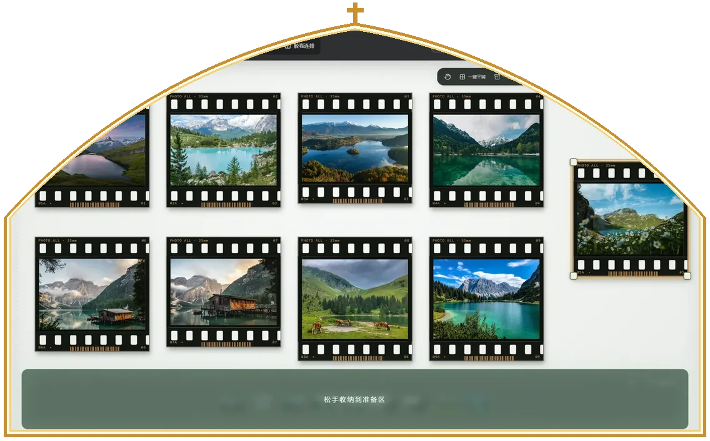
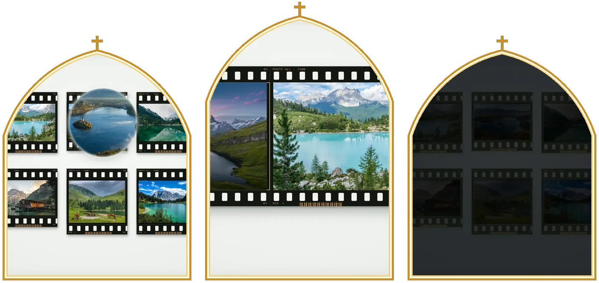

<picture>
  <source media="(prefers-color-scheme: dark)" srcset="assets/banner-dark.svg">
  
</picture>

  <b>中文</b> ｜ <a href="#english">English ↓</a> ｜ <a href="https://yzh2006517.github.io/">个人网站</a> ｜ <a href="mailto:zhenhao897@gmail.com">zhenhao897@gmail.com</a>

<i>Vos estis lux mundi</i> —— 你们是世上的光（马太福音 5:14）

花心思最多的是 <b>Photo All</b>：Windows 上是一张电子观片台，Android 上是一台胶片相机。 都免费开源，照片只留在你自己的设备上。

<picture>
  <source media="(prefers-color-scheme: dark)" srcset="assets/divider-dark.svg">
  
</picture>

<a href="https://github.com/YZH2006517/Photo-All">
  <picture>
    <source media="(prefers-color-scheme: dark)" srcset="assets/plate-studio-dark.svg">
    
  </picture>
</a>

<i>Et lux in tenebris lucet</i> —— 光照在黑暗里（约翰福音 1:5）

<h3 align="center">让照片，慢慢发光。</h3>

一张可以开灯、摆片、放大细节的电子观片台，也是一套从选片到修图出片的本地工作台。 <b>免费开源 · 本地处理 · 原片只读</b>

| 按键 | 观片台 | |
| :-: | --- | --- |
| <kbd>G</kbd> | **自由摆片** | 拖动、逐张缩放、一键平铺。台面怎么摆，下次回来还是那样。 |
| <kbd>V</kbd> | **拿起放大镜** | 在鼠标位置开镜，倍率和镜片尺寸分开调，镜外还看得见整张台面。 |
| <kbd>C</kbd> | **连续胶卷** | 首尾相接，横向滑动。可以自动播放，手一碰就停。 |
| <kbd>I</kbd> | **只剩照片** | 按空格或碰到屏幕边缘才唤出工具，片孔、边框装饰都能关。 |
| <kbd>L</kbd> | **关灯** | 关灯后照片只透一点光，底色有米黄、暖灰、灰黑，也能自定义。 |
| ⌂ | **胶片收藏室** | 图集分卷收上三维胶卷架，每卷 36 帧。选一卷，暗盒落桌、胶片展开。 |

<i>Ecce nova facio omnia</i> —— 看哪，我将一切都更新了（启示录 21:5）

<b>126</b> 款开放 LUT　·　<b>17</b> 款创意风格　·　<b>16</b> 款 Spektrafilm 色彩　·　<b>16</b> 层可叠加

<b>先曝光，再冲印。</b>照片先按片种的光谱数据曝光到胶片，再经放大机印到相纸，不是简单套一层颜色： 
Ⅰ 胶片 → Ⅱ 显影 → Ⅲ 放大机 → Ⅳ 相纸

35mm、120、扫描毛边、幻灯片、相纸留白——给每张照片配一条片边，卷名、日期、帧号和签名都能自己写。

<a href="https://github.com/YZH2006517/Photo-All/releases"><b>免费下载</b></a> · <a href="https://github.com/YZH2006517/Photo-All">源码</a> · <a href="https://yzh2006517.github.io/#photo">个人网站上看</a> Windows 10/11 x64 ｜ GPL-3.0

<picture>
  <source media="(prefers-color-scheme: dark)" srcset="assets/divider-dark.svg">
  
</picture>

<a href="https://github.com/YZH2006517/Photo-All-Android">
  <picture>
    <source media="(prefers-color-scheme: dark)" srcset="assets/plate-android-dark.svg">
    
  </picture>
</a>

<i>Omnia tempus habent</i> —— 凡事都有定期（传道书 3:1）

<h3 align="center">按下快门，剩下的交给暗房。</h3>

取景时就能看到胶片效果。按下快门后，照片（默认 RAW）在手机 GPU 上冲洗： 曝光到胶片、显影、再印放到相纸——从 RAW 到成片约 3 秒。

<b>22</b> 种胶片　·　<b>9</b> 种相纸　·　<b>416</b> 个创意 LUT　·　<b>≈3 秒</b> RAW 到成片

| | |
| --- | --- |
| **取景就是成片** | 取景器实时预览胶片效果，和成片的亮度、色彩对得上。 |
| **快门变旋钮** | 在快门上画圈调 LUT 强度，顺时针更浓、逆时针更淡，边转边看。 |
| **会收着打的闪光** | 一帧环境光加一帧闪光，在 RAW 里重新配比，压暗背景、突出主体。 |
| **横过来就是机身** | 横屏时左下角浮起一片发光扇形，点它切到带滚轮、刻度波轮和镜头盘的布局。 |
| **五套主题** | 暗盒、暗房红灯（夜拍只用红光）、相纸、黄铜、冷银。 |
| **每一张都有档案** | 相机、曝光、白平衡、对焦，冲洗引擎的每个决定，一键复制。 |

<a href="https://github.com/YZH2006517/Photo-All-Android/releases"><b>下载 APK</b></a> · <a href="https://github.com/YZH2006517/Photo-All-Android">源码</a> Android 10+ ｜ arm64 ｜ Vulkan 1.1

<picture>
  <source media="(prefers-color-scheme: dark)" srcset="assets/divider-dark.svg">
  
</picture>

<i>In principio erat Verbum</i> —— 太初有道（约翰福音 1:1）

<b><a href="https://github.com/YZH2006517/ai-virtual-streamer">AI 虚拟主播</a></b> 一个 Live2D 主播看着抖音弹幕陪观众聊天，还能跟着音乐跳舞、主持弹幕小游戏。 Python · Live2D · Edge TTS ｜ MIT

<i>Pulsate et aperietur vobis</i> —— 叩门，就给你们开门（马太福音 7:7） 欢迎工作机会、科研交流与开源协作。 📮 <a href="mailto:zhenhao897@gmail.com">zhenhao897@gmail.com</a> ｜ 🌐 <a href="https://yzh2006517.github.io/">yzh2006517.github.io</a>

✠ SOLI DEO GLORIA ✠

---

<h2 align="center" id="english">English</h2>

<a href="https://github.com/YZH2006517">↑ 中文</a> ｜ <b>English</b>

Most of my care goes into <b>Photo All</b>: a light table on Windows, a film camera on Android. Both are free, open source, and keep your photos on your own device.

### [Photo All Studio](https://github.com/YZH2006517/Photo-All) — let your photos slowly glow

*Et lux in tenebris lucet* — And the light shineth in darkness (John 1:5)

A light table you can switch on, lay photos across and magnify — and a local workbench that goes from picking to grading to the final print. **Free & open source · processed locally · originals read-only.**

| Key | The light table | |
| :-: | --- | --- |
| <kbd>G</kbd> | **Lay them out freely** | Drag, resize one by one, tile in one key. The table stays the way you left it. |
| <kbd>V</kbd> | **Pick up the loupe** | A refracting lens opens where the cursor is; the rest of the table stays in view. |
| <kbd>C</kbd> | **A continuous roll** | Frames join end to end and slide sideways; it plays itself and pauses when touched. |
| <kbd>I</kbd> | **Nothing but the photos** | Tools appear only on Space or at the screen edge. |
| <kbd>L</kbd> | **Lights off** | The photos let only a little light through — beige, warm grey or charcoal beneath. |
| ⌂ | **The film archive** | Albums become rolls of 36 frames on a 3D shelf; pick one and it unrolls on the desk. |

**126** open LUTs · **17** creative looks · **16** Spektrafilm stocks · **16** stackable layers. Expose first, then print: film → develop → enlarger → paper, not a colour filter laid on top. Borders in 35mm, 120, rough scan, slide mount or paper margin, with your own roll name, date, frame number and signature.

[**Free download**](https://github.com/YZH2006517/Photo-All/releases) · [Source](https://github.com/YZH2006517/Photo-All) — Windows 10/11 x64, GPL-3.0

### [Photo All · Film Camera](https://github.com/YZH2006517/Photo-All-Android) — press the shutter, the darkroom does the rest

*Omnia tempus habent* — To every thing there is a season (Ecclesiastes 3:1)

The viewfinder already shows the film. After the shot, the photo (RAW by default) is developed on the phone's GPU — exposed to film, developed, printed to paper — in about three seconds. **22** film stocks · **9** papers · **416** creative LUTs.

| | |
| --- | --- |
| **The viewfinder is the print** | Live film preview that matches the final brightness and colour. |
| **The shutter becomes a dial** | Circle the shutter to set LUT strength — clockwise richer, anticlockwise lighter. |
| **Flash that holds back** | One ambient frame plus one flash frame, re-balanced in RAW to darken the background. |
| **Turn it sideways** | A glowing fan appears; tap it for a layout with a scroll wheel, dial and lens ring. |
| **Five themes** | Film canister, darkroom red light, paper, brass, cold silver. |
| **Every frame remembered** | Camera, exposure, focus and every decision the engine made, one tap to copy. |

[**Download APK**](https://github.com/YZH2006517/Photo-All-Android/releases) · [Source](https://github.com/YZH2006517/Photo-All-Android) — Android 10+, arm64, Vulkan 1.1

### Also

[**AI Virtual Streamer**](https://github.com/YZH2006517/ai-virtual-streamer) — a Live2D host that reads the Douyin live chat, talks back, dances to the music and runs chat minigames. MIT.

*Pulsate et aperietur vobis* — Knock, and it shall be opened unto you (Matthew 7:7). Open to jobs, research and open-source collaboration: [zhenhao897@gmail.com](mailto:zhenhao897@gmail.com) · [yzh2006517.github.io](https://yzh2006517.github.io/)

✠ SOLI DEO GLORIA ✠

