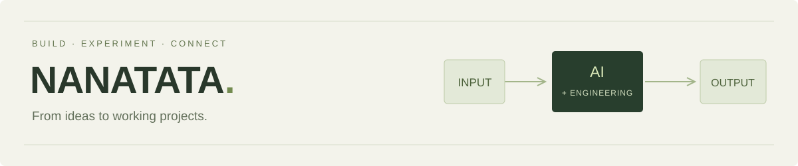

# 你好，我是 NANATATA 👋

**把想法，做成能用的东西。**

关注 AI 应用、模型实验与软硬件交互，喜欢把技术放进具体场景，做出可以体验的作品。

[个人网站](https://yzh2006517.github.io/) · [联系邮箱](mailto:zhenhao897@gmail.com)

## 精选项目

### [AI 直播助手](https://yzh2006517.github.io/work/ai-live-assistant.html)

一个连接弹幕、语言模型、语音与直播画面的 Windows 桌面应用。让 AI 根据观众的问题组织展示内容，也能切换唠嗑模式，陪观众聊天、主持互动小游戏。

| 能力 | 实现重点 |
| --- | --- |
| 动态组合展示 | 根据问题选择相关项目，组合展示、逐项圈选与切换详情 |
| 口播同步导播 | 把语音与指令绑定到同一播放片段，在对应句子开口时更新画面 |
| 规则与人工控制 | 推荐条件校验、画面锁定、人工接管与导播记录 |
| 唠嗑与小游戏 | 独立人设和活动上下文，程序负责判题计分，AI 负责主持串场 |

[▶ 查看项目视频](https://yzh2006517.github.io/work/ai-live-assistant.html#concept) · [技术架构](https://yzh2006517.github.io/work/ai-live-assistant.html#architecture) · [运行流程](https://yzh2006517.github.io/work/ai-live-assistant.html#runtime)

## 关注方向

- **AI 应用**：让模型的理解与生成能力进入具体的产品场景。
- **人机交互**：连接语言、语音、画面与实际动作。
- **工程实践**：关注完整链路、状态管理、异常情况和可控执行。

## 联系我

欢迎工作机会、科研交流、开源协作与项目合作。

📮 **[zhenhao897@gmail.com](mailto:zhenhao897@gmail.com)**  
🌐 **[yzh2006517.github.io](https://yzh2006517.github.io/)**
